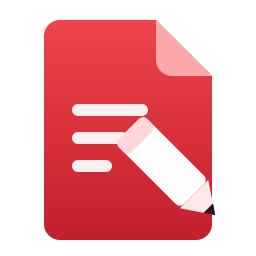

# PDF Editor



A fast, private PDF editor for Windows: read, edit text and images, organize pages, fill and sign,
comment, protect and export, with Arabic and English text editing. Everything runs on your
computer: no account, no telemetry, no cloud processing.

PDF Editor is built on the open-source [PdfCraft](https://github.com/storytold/pdfcraft) engine
(MIT OR Apache-2.0), with its own app, features and improvements on top.
See [NOTICE](NOTICE), [ATTRIBUTION.md](ATTRIBUTION.md) and the licence files.

## What is different from PdfCraft

- PDF Editor name and red document-and-pencil icon; upstream branding and community links removed.
- A dark, modern theme by default with a red accent, and a redesigned home page.
- Updates are checked against [aliramadann/pdf-editor-support](https://github.com/aliramadann/pdf-editor-support/releases).

## Build (Windows)

Install Rust (MSVC toolchain) and the Visual Studio C++ build tools, then:

```powershell
git clone https://github.com/storytold/craft-fonts ../craft-fonts
$env:CRAFT_FONTS_DIR = (Resolve-Path ../craft-fonts).Path
cargo build --release -p pdfcraft
```

The app is `target/release/pdfcraft.exe`. Installers are built by the `release` GitHub workflow.

Support and privacy: https://aliramadann.github.io/pdf-editor-support/

## iPhone and iPad

`ios/` is a native SwiftUI app (PDFKit viewer, iOS text editing, document camera) over the same
Rust engine (`crates/mobile`, a C interface to the automation tools). Double-click
**Build iOS.bat**: inside WSL it builds the engine for iPhone, fetches the OCR models, and runs
`xtool dev` to sign and install the app on your connected iPhone (`"Build iOS.bat" --ipa` makes a
`.ipa` instead). Needs WSL with xtool set up (`xtool setup`, signed in with your Apple ID).
For App Store releases the same package opens in Xcode (`xtool dev generate-xcode-project`).
